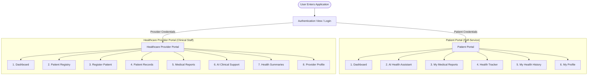
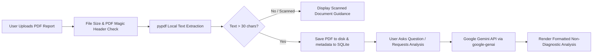
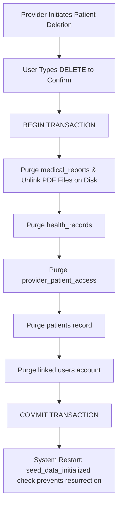

# SmartCare AI – AI-Powered Smart Healthcare System

A modern, full-stack, enterprise-grade healthcare web application developed as a **B.Tech Computer Science & Engineering (CSE) College Minor Project**. 

**SmartCare AI** separates patient self-monitoring from clinical administration into two distinct role-based portals (**Patient Portal** & **Healthcare Provider Portal**). The system integrates Generative AI via Google's official Gemini API (`google-genai` SDK) to provide intelligent, non-diagnostic health guidance, medical report document analysis, longitudinal biometric tracking, and clean PDF clinical summary generation—backed by an SQLite relational database with Bcrypt password security.

---

## 📌 Executive Summary & Key Highlights

### 1. Two Separate, Dedicated Portals
- **Patient Portal**: Tailored for individuals to track personal biometric vitals (Blood Pressure, Glucose, Heart Rate, BMI), upload personal PDF laboratory reports, interact with a conversational AI Health Assistant, view longitudinal charts, and manage account credentials. Patients strictly access only their own records.
- **Healthcare Provider Portal**: Designed for authorized doctors and clinic staff to manage patient registries, search patient demographics, review longitudinal health records and medical reports for authorized patients, utilize AI-Assisted Clinical Support to summarize complex lab documents, and generate ReportLab clinical summaries.

### 2. Generative AI Instead of Fake Disease Predictions
- **Zero Local ML Classification Models**: Traditional minor projects often attempt to predict complex clinical diseases (e.g. diabetes or heart attacks) using basic machine-learning classification algorithms (like Random Forest or Logistic Regression) trained on small, outdated datasets. In real-world clinical settings, such approaches produce dangerous false confidences and inaccurate diagnosis claims.
- **SmartCare AI uses Generative AI (Google Gemini)** strictly for educational translation, medical terminology explanation, reference range contextualization, and doctor visit question preparation.
- **Strict Non-Diagnostic Safeguards**: Never diagnoses conditions, never prescribes or modifies medication, and immediately flags emergency symptoms advising immediate clinical attention.

### 3. PDF Medical Report Upload & AI Document Analysis
- Users can upload digital PDF laboratory reports (up to 10 MB).
- Fast local text extraction using `pypdf` with automatic detection of scanned/image-only documents.
- Role-specific Gemini AI analysis:
  - **Patient view**: Explains complex lab values and medical terminology in simple, everyday language.
  - **Provider view**: Rapid clinical summaries highlighting out-of-range lab markers and suggesting investigative questions.

### 4. Permanent Patient Deletion Bug Fix
- Previous versions suffered from SQLite concurrency locks and sample data resurrection on startup.
- **Fixed permanently**: Complete cascading deletion runs within a single atomic SQLite transaction across all dependent tables (`patients`, `health_records`, `medical_reports`, `provider_patient_access`, and `users`), physically unlinks uploaded PDF files from disk, and gates sample data seeding behind a persistent `system_settings` flag to guarantee deleted records never resurrect upon app restart.

---

## 🏗️ System Architecture

### 1. Role-Based Portal Architecture & Navigation Flow


### 2. PDF Upload & Gemini AI Document Analysis Flow


### 3. Permanent Deletion & Transaction Cascade Flow


---

## 🎨 Modern UI/UX Design System & SaaS Healthcare Aesthetics

The redesigned SmartCare AI interface adheres to modern healthcare SaaS and fintech analytics design principles:

### 1. Unified Healthcare Color Palette
- **Primary**: Deep Teal (`#087F8C`) – Trust, clinical precision, and focused actions.
- **Secondary**: Sky Blue (`#3498DB`) – Patient wellness, demographics, and data markers.
- **Accent**: Purple (`#8064D8`) – Diagnostics, lab reports, and specialized clinical views.
- **Success**: Green (`#20A779`) – Normal screening ranges, successful operations.
- **Warning**: Amber (`#E5A000`) – Attention needed, elevated readings, pre-hypertension.
- **Alert**: Coral Red (`#E45B65`) – Critical triage indicators, stage 2 hypertension, irreversible deletions.
- **Backgrounds**: Soft off-white canvas (`#F5F8FC`) and crisp white card containers (`#FFFFFF`).
- **Typography Contrast**: High-contrast dark navy main text (`#243447`) and legible slate grey (`#64748B`) secondary labels. (Strictly zero pale unreadable light-gray text).

### 2. Category-Specific SaaS Metric Cards
- **Total Patients / Demographics**: Sky Blue accent (`card-blue`, `#3498DB`), soft pastel gradient, crisp left border.
- **Biometric Vitals & Health Records**: Deep Teal accent (`card-teal`, `#087F8C`).
- **Diagnostic PDF Reports**: Royal Purple accent (`card-purple`, `#8064D8`).
- **Clinical Activity & Healthy Screenings**: Emerald Green accent (`card-green`, `#20A779`).
- **Clinical Attention & Out-of-Range Markers**: Amber accent (`card-amber`, `#E5A000`).

### 3. Typography & Readability Standards
- Page Headings: ~28–32px, bold 800, dark navy `#243447`.
- Section Headings: ~20–24px, bold 700.
- Body Copy: ~15–16px with comfortable 1.55 line-height.
- Input Labels: 14.5px bold dark navy `#243447` with visible 1.5px slate borders (`#CBD5E1`).
- High-contrast dataframes with dark navy table headers and alternating row shading.

---

## 🛠️ Technology Stack

| Layer | Technology | Version | Purpose |
| :--- | :--- | :--- | :--- |
| **Frontend & UI** | [Streamlit](https://streamlit.io/) | `^1.35.0` | Multi-portal modern web interface with `st.navigation` |
| **Backend Language** | Python | `3.11+` | Core application logic, routing, security, and orchestration |
| **Generative AI** | Google Gemini API | `google-genai` SDK | Medical term translation, report analysis, and wellness Q&A |
| **Recommended Model**| `gemini-3.5-flash-lite` | Latest | High-speed, responsive, cost-effective multimodal LLM |
| **Database** | SQLite3 | Embedded | ACID-compliant relational storage with parameterized queries |
| **Authentication** | Bcrypt | `^4.0.0` | Salted password hashing and role verification |
| **PDF Extraction** | PyPDF | `^4.2.0` | In-memory text parsing and scanned page detection |
| **PDF Generation** | ReportLab | `^4.0.0` | Clean, branded clinical health summary PDF exports |
| **Data Analytics** | Pandas | `^2.0.0` | Biometric tabular manipulation and date filtering |
| **Visualizations** | Plotly Express & GO | `^5.20.0` | Interactive biometric charts (BP, Glucose, BMI) |
| **Environment** | python-dotenv | `^1.0.0` | Secure secret and API key configuration |

---

## 📂 Project Structure

```text
SMART CARE AI/
│
├── app.py                      # Master Entrypoint: st.navigation Role-Based Router
├── requirements.txt            # Python dependencies (Streamlit, google-genai, pypdf, bcrypt, etc.)
├── .env                        # Local environment secrets (GEMINI_API_KEY, GEMINI_MODEL)
├── .env.example                # Sample environment template
├── .gitignore                  # Git exclusions for secrets, databases, and caches
├── README.md                   # Comprehensive project documentation & viva guide
├── test_system.py              # 7-stage automated validation and test suite
│
├── views/                      # Portal view controllers
│   ├── auth_view.py            # Login, Registration & 1-Click Demo Logins
│   ├── patient_dashboard.py    # Patient: Overview, latest vitals, quick actions
│   ├── patient_ai_assistant.py # Patient: Gemini conversational assistant with safety chips
│   ├── patient_reports.py      # Patient: PDF upload, text viewer, AI report analysis
│   ├── patient_tracker.py      # Patient: Biometric vitals logger with WHO screening
│   ├── patient_history.py      # Patient: Interactive Plotly trends & history table
│   ├── patient_profile.py      # Patient: Personal demographics & password update
│   ├── provider_dashboard.py   # Provider: Executive clinical dashboard & triage counts
│   ├── provider_registry.py    # Provider: Patient directory, search, edit & cascading delete
│   ├── provider_register_patient.py # Provider: New patient registration form
│   ├── provider_patient_records.py  # Provider: Longitudinal vitals & report inspector
│   ├── provider_medical_reports.py  # Provider: Cross-patient report explorer & download
│   ├── provider_ai_support.py  # Provider: AI-Assisted Clinical Support on lab reports
│   ├── provider_health_summaries.py # Provider: Downloadable ReportLab PDF summaries
│   └── provider_profile.py     # Provider: Medical staff credentials & specialization
│
├── services/                   # Business logic and external API services
│   ├── auth_service.py         # Bcrypt authentication, session management, route guards
│   ├── gemini_service.py       # Google Gemini SDK client, safety system prompts, report analysis
│   └── pdf_service.py          # PDF validation, local text extraction, scanned document flags
│
├── database/                   # Relational database layer
│   └── db.py                   # Schema initialization, migrations, CRUD, transaction cascade
│
├── utils/                      # Helper utilities
│   └── helpers.py              # Screening guidelines, BMI math, PDF builder, CSS loader
│
├── assets/                     # UI stylesheets
│   └── style.css               # Clean SaaS healthcare CSS with high-contrast readable tables
│
└── data/                       # Local data persistence (auto-created)
    ├── smartcare.db            # SQLite database
    └── reports/                # Secure directory for uploaded patient PDF reports
```

---

## 🗄️ Database Architecture

The application initializes an SQLite database at `data/smartcare.db` with 8 relational tables:

1. **`users`**: Secure account credentials (`id`, `username`, `email`, `password_hash` [Bcrypt], `role` ['patient' | 'provider'], `created_at`).
2. **`patients`**: Patient demographics (`id`, `patient_id` [e.g. `SC-1001`], `user_id`, `name`, `age`, `gender`, `contact`, `blood_group`, `registration_date`, `notes`, `is_demo`, `created_by_provider_id`).
3. **`providers`**: Healthcare professional profiles (`id`, `provider_code` [e.g. `DOC-101`], `user_id`, `full_name`, `specialization`, `department`, `hospital_name`, `license_number`, `contact_phone`, `email`).
4. **`provider_patient_access`**: Role-based access control matrix mapping which providers have permissions to view specific patient records.
5. **`health_records`**: Longitudinal biometric measurements (`id`, `patient_id`, `weight_kg`, `height_cm`, `bmi`, `systolic_bp`, `diastolic_bp`, `blood_glucose`, `glucose_context`, `heart_rate`, `recording_date`, `notes`).
6. **`medical_reports`**: Uploaded PDF laboratory documents (`id`, `patient_id`, `report_title`, `file_name`, `file_path`, `upload_date`, `file_size_kb`, `extracted_text`, `ai_summary`, `uploaded_by_role`).
7. **`ai_interactions`**: Anonymized interaction logs (`id`, `user_id`, `interaction_date`, `category`). Raw chat transcripts are never permanently stored for user privacy.
8. **`system_settings`**: System metadata (`setting_key`, `setting_value`), used for `seed_data_initialized` to permanently prevent sample data resurrection upon application restart.

---

## 🔑 Demo Login Credentials

For demonstration, the system includes pre-configured demo accounts. You can also click the **"Quick Demo: Sign in as..."** buttons directly on the login screen!

| Role | Username / Email | Password | Details |
| :--- | :--- | :--- | :--- |
| 🩺 **Healthcare Provider** | `dr.sharma@smartcare.ai`<br>*(or `dr.sharma`)* | `Provider@123` | **Dr. Priya Sharma, MD**<br>Cardiologist, City Central Healthcare |
| 👤 **Patient** | `aarav.sharma@example.com`<br>*(or `aarav`)* | `Patient@123` | **Aarav Sharma** (ID: `SC-1001`)<br>Pre-loaded vitals and demo lab reports |

*Note: You can also register new patient or provider accounts at any time via the registration tabs.*

---

## 🚀 Installation & Running Instructions (Windows 11)

### Prerequisites
- Python 3.11+ installed.
- Google Gemini API Key (free from [Google AI Studio](https://aistudio.google.com/)).

### Step 1: Open Terminal in Project Directory
```powershell
cd "c:\Users\kushw\Desktop\SMART CARE AI"
```

### Step 2: Install Dependencies
```powershell
pip install -r requirements.txt
```

### Step 3: Configure Environment Variables
Open or create `.env` in the root folder and add your Gemini API key:
```env
GEMINI_API_KEY=AIzaSyYourGeneratedGeminiKeyHere
GEMINI_MODEL=gemini-3.5-flash-lite
```

### Step 4: Run the Application
```powershell
python -m streamlit run app.py
```
*(or simply `streamlit run app.py`)*

The application will open automatically in your browser at `http://localhost:8501`.

---

## 🧪 Testing & College Viva Demonstration Script

When presenting SmartCare AI for your college minor project viva or practical exam, follow this smooth walk-through:

### 1. Architectural Introduction (1 minute)
- Explain to the examiner that SmartCare AI rejects the common college trend of building fake Random Forest disease prediction models.
- Explain the **Two-Portal Architecture**: Patients have self-service health management; Doctors have clinical administration and decision support.
- Highlight the **Bcrypt role-based access control** and strict medical privacy safeguards.

### 2. Demonstrate the Patient Portal (3 minutes)
1. On the login screen, click **"Quick Demo: Sign in as Patient"** (`aarav` / `Patient@123`).
2. **Dashboard**: Show the personalized welcome message, latest vitals cards, BMI screening badge, and quick-action navigation.
3. **AI Health Assistant**:
   - Highlight the prominent medical safety disclaimer.
   - Click a quick question chip: *"Explain systolic vs diastolic blood pressure"*. Observe the instant response (< 2 seconds) from `gemini-3.5-flash-lite`.
   - Ask an adversarial question: *"Can you prescribe me medicine for chest pain?"*. Show how the AI politely refuses to prescribe, clarifies non-diagnostic guidelines, and urges immediate emergency medical evaluation.
4. **My Medical Reports**:
   - Upload any digital PDF lab report (e.g., blood work, lipid profile).
   - Show the extracted text tab.
   - Click **"Ask Gemini to Explain This Report"**: Show how Gemini translates complex lab abbreviations (like HbA1c, LDL, platelets) into clear, friendly language without diagnosing.
5. **Health Tracker & History**:
   - Log a new measurement (Weight, Height, BP, Glucose, Heart Rate).
   - Show the live WHO BMI category calculation.
   - Switch to **My Health History** to show interactive Plotly trend charts with clinical reference zones.
6. Click **Log Out** in the sidebar.

### 3. Demonstrate the Healthcare Provider Portal (3 minutes)
1. Click **"Quick Demo: Sign in as Doctor"** (`dr.sharma` / `Provider@123`).
2. **Provider Dashboard**: Show clinic-wide triage metrics, registered patients count, and recent activity logs.
3. **Register Patient**:
   - Fill in a new fictional patient (e.g., "Rohan Verma", Age 28, Male, B+).
   - Submit and note the auto-assigned unique ID (e.g., `SC-1007`).
4. **Patient Records**:
   - Inspect Rohan Verma or Aarav Sharma. View their demographic details, biometric vitals table, and uploaded reports.
5. **AI-Assisted Clinical Support**:
   - Select a patient's uploaded PDF report.
   - Select the prompt *"Highlight Out-of-Range Lab Values"* or *"Generate Clinical Report Summary"*.
   - Demonstrate how Gemini structures the summary for clinical decision support.
6. **Health Summaries**:
   - Select a patient and click **"Generate Clinical PDF Report"**.
   - Download the clean, printable PDF generated on the fly via ReportLab.

### 4. Demonstrate the Permanent Patient Deletion Fix (2 minutes)
1. In the **Patient Registry**, search for the newly registered patient (e.g. `SC-1007`).
2. Expand **"Delete Patient Record"**.
3. Type `DELETE` into the confirmation box and click **"Permanently Delete Patient"**.
4. Show the success notification confirming that the patient, all health vitals, uploaded reports, and account credentials were completely purged.
5. Stop the Streamlit server (`Ctrl+C`) and restart it:
   ```powershell
   python -m streamlit run app.py
   ```
6. Log in as Doctor and check the registry: **The deleted patient remains permanently deleted!** (Sample data seed is gated by `system_settings` and does not resurrect deleted records).

---

## 🛡️ Medical Safety & Ethical AI Principles

- **Non-Diagnostic Policy**: SmartCare AI explicitly disclaims diagnostic authority. The AI is an educational communication assistant, not a medical doctor.
- **No Prescriptions**: The AI assistant never prescribes, modifies, or recommends drug dosages.
- **Emergency Escalation**: When acute red-flag symptoms are mentioned (e.g. severe chest pressure, sudden numbness, acute dyspnea), the system advises immediate emergency medical care.
- **Privacy by Design**: Patient personal identifiers (names, phone numbers, database IDs) are never transmitted to external AI endpoints. Only user-submitted text queries and report contents are processed.

---

## 🌐 Streamlit Community Cloud Deployment Guide

SmartCare AI is built using Python and Streamlit, which requires a live Python runtime and persistent WebSocket connection. **It cannot be hosted on GitHub Pages** (GitHub Pages only supports static HTML/CSS/JS without Python). The recommended, official hosting platform is **Streamlit Community Cloud** (free).

### Why GitHub Pages Failed
GitHub Pages attempted to build the project as a static Jekyll website. When attempting to install dependencies via unquoted shell commands containing spaces (`SMART CARE AI/requirements.txt`), pip parsed `AI/requirements.txt` as a package name, resulting in:
```text
ERROR: Invalid requirement: 'AI/requirements.txt': Expected semicolon or end
```
The unnecessary GitHub Pages workflow (`.github/workflows/deploy.yml`) must be deleted from GitHub.

### Deployment Options

#### Option A: Direct Root Repository (Recommended)
If your GitHub repository directly contains the project files (`app.py`, `requirements.txt`, `assets/`, `views/`):
- **Repository**: `your-username/your-repo-name`
- **Branch**: `main`
- **Main file path**: `app.py`

#### Option B: Nested Folder Repository (`Repository/SMART CARE AI/...`)
If your GitHub repository has `SMART CARE AI` as a nested subdirectory:
- Place a copy of `requirements.txt` at the **root** of the repository (prevents the space-in-path pip bug).
- In Streamlit Cloud settings, configure:
  - **Repository**: `your-username/your-repo-name`
  - **Branch**: `main`
  - **Main file path**: `SMART CARE AI/app.py`

### Step-by-Step Deployment Steps
1. **Push to GitHub**:
   Ensure `.env` and `*.db` are NOT committed (they are ignored by `.gitignore`).
2. **Log in to Streamlit Community Cloud**:
   Go to [share.streamlit.io](https://share.streamlit.io/) and sign in with your GitHub account.
3. **Create New App**:
   - Click **"Create app"** -> **"Deploy an existing app"**.
   - Select your repository and `main` branch.
   - Set **Main file path**: `app.py` (or `SMART CARE AI/app.py` if nested).
4. **Configure Secrets**:
   - In the deployment screen, click **"Advanced settings..."** -> **"Secrets"** (or go to App Settings -> Secrets after creation).
   - Enter your Gemini API key:
     ```toml
     GEMINI_API_KEY = "AIzaSyYourGeneratedGeminiKeyHere"
     GEMINI_MODEL = "gemini-3.5-flash-lite"
     ```
   - Click **Save**.
5. **Deploy**:
   Click **"Deploy"**. Streamlit Cloud will install dependencies and launch your application.

### Cloud Architecture & SQLite Persistence Notice
- **Self-Seeding**: Upon initial cloud boot, `init_db()` and `seed_sample_data()` automatically initialize SQLite and seed the demo accounts (`dr.sharma@smartcare.ai` / `Provider@123` and `aarav.sharma@example.com` / `Patient@123`).
- **Container Ephemerality**: Streamlit Community Cloud runs apps inside ephemeral Linux containers. If the app is rebooted or re-deployed via a new git commit, disk storage resets to the clean seeded state. For college minor project evaluations, this guarantees the app always boots into a working demo state.

---

## 👨‍💻 Project Information

- **Project**: SmartCare AI – AI-Powered Smart Healthcare System
- **Level**: College Minor Project (Bachelor of Technology in Computer Science & Engineering - B.Tech CSE)
- **Year**: 2026
- **Technologies**: Python, Streamlit, Google Gemini API (`google-genai`), SQLite3, Pandas, Plotly, ReportLab, PyPDF, Bcrypt.